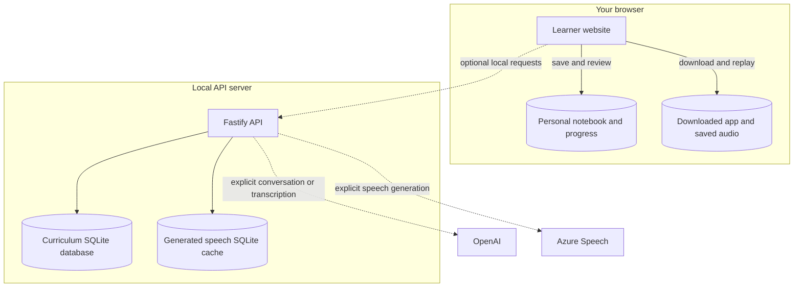
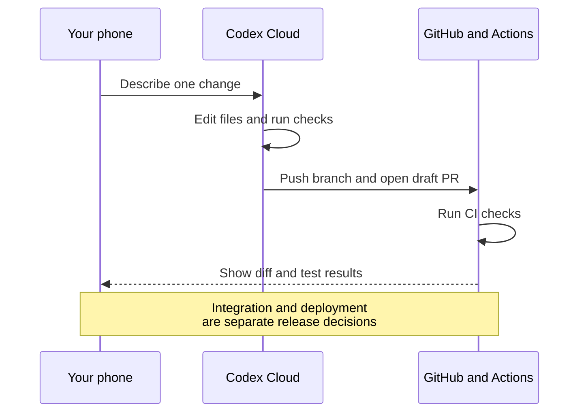
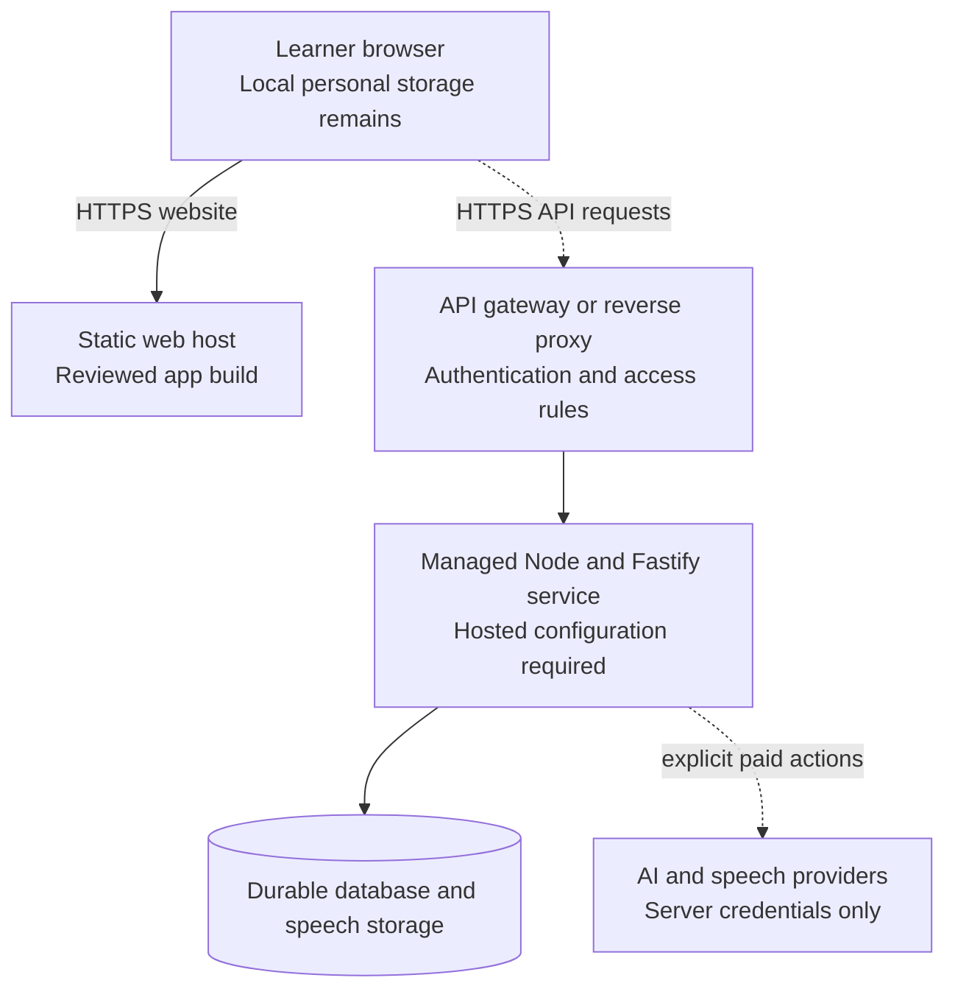

# SmartLingo architecture and deployment explained

Updated 16 November 2026. Start here for the big picture; use [Architecture](ARCHITECTURE.md) for implementation rules and [Cloud workflow](CLOUD_WORKFLOW.md) for the current setup checklist.

SmartLingo has a working web learner and a local server for editing and optional AI features. GitHub stores its source, and Codex Cloud lets us develop that source from your phone. A publicly hosted learner website is a separate delivery step.

The diagrams use Mermaid, which [GitHub displays inside Markdown files](https://docs.github.com/en/get-started/writing-on-github/working-with-advanced-formatting/creating-diagrams). Each diagram also has a plain-English explanation.

## 1 The big picture

Think of the learner website as the part you touch, the API as a service desk, and the databases as separate notebooks. The frontend is the interface in the browser; the backend is the server. An API is the agreed way the interface requests a service and receives a reply. The website can teach bundled lessons without contacting the service desk. Editing shared curriculum or requesting a new AI reply needs the API.



**Read the diagram:** the browser owns personal learning data and downloaded assets. The API owns curriculum revisions and the server speech cache. Only the API talks to paid providers; permanent provider keys stay there. Dashed connections are optional features, not a requirement for ordinary bundled study.

Current practical behaviour:

| Activity | What it needs |
| --- | --- |
| Read bundled vocabulary, examples and dialogues | Learner website; no API key |
| Practise, save a word and review it | Browser storage; no API key |
| Study offline | A previously downloaded, verified app copy and its saved content |
| Replay device speech | An available device/browser voice; availability can vary offline |
| Replay saved neural speech | The exact clip already saved in this browser; no new generation |
| Edit, preview and publish a curriculum revision | Local API and its curriculum database |
| Generate an AI reply, transcription or neural clip | Local API, network and configured provider credentials; an explicit action |

The app currently contains 25 topic banks and 123 lessons. Bundled curriculum remains draft material for owner review. Software working correctly does not mean every lesson has been approved for public release.

## 2 How the repository is organised

One Git repository holds several related packages. This is called a **monorepo**: the learner, API and shared rules can change together while keeping their responsibilities separate.

```text
SmartLingo/
  apps/
    learner/       Screens, browser storage, audio and offline behaviour
    api/           Local server, curriculum database and provider adapters
  packages/
    domain/        Shared rules, types and validation
    content/       Versioned lesson data and curriculum validation
  tests/           Browser and offline journeys
  scripts/         Build, preview, verification and backup tools
  docs/            Guides, status, plans and decisions
  .github/         Automated GitHub checks
  .agents/skills/  Reusable project workflows for Codex
  .codex/          Project agent and hook definitions
```

| Part | Its job | Example |
| --- | --- | --- |
| `apps/learner` | Display the learning experience and respond to actions | Show a word card; save a personal note |
| `apps/api` | Handle validated server requests and persistence | Save an immutable draft revision; call a speech provider |
| `packages/domain` | Keep learning rules consistent across interfaces | Check a sentence; calculate a review date; validate a request |
| `packages/content` | Supply original lesson data with stable IDs and revisions | Keep a saved word linked to the same vocabulary sense |
| Provider and storage adapters | Translate small typed contracts into external operations | Write to IndexedDB or SQLite; send a provider request |

This separation makes later changes easier. For example, a future native storage adapter can reuse the review rules. It does not mean native apps or account synchronisation are already implemented. Shared UI extraction into `packages/ui` is deferred until there is actual reuse; current UI components live in the learner app.

## 3 Where data lives and what GitHub backs up

There is more than one kind of data. Keeping them separate avoids accidentally treating a source-code backup as a backup of your learning. IndexedDB is a browser database; CacheStorage holds website/audio files in the browser; SQLite stores structured records in a server-managed database file.

| Data | Current location | How it survives |
| --- | --- | --- |
| Source code and bundled lessons/photos | Git repository | Committed changes can be pushed to GitHub |
| Personal words, notes, progress and review events | Browser IndexedDB | Reloading the same browser origin preserves it; use the learner backup export for recovery or transfer |
| Explicitly loaded published lesson cache | Browser IndexedDB | Cached in that browser and included in the learner backup |
| Downloaded website assets and verified neural clips | Browser CacheStorage | Separate from IndexedDB; download/re-save them on another browser |
| Device voice/rate and other browser preferences | Browser preferences/local storage | Not the same store as the learning notebook |
| Owner curriculum edits, revision history and publications | API SQLite database | Use the separate curriculum backup/restore commands |
| Generated server clips, text and durable speech attempts | Separate API speech SQLite database | Separate retention/cache; excluded from learner and curriculum backups |
| Temporary conversation and recording data | Browser/server memory during the flow | Cleared on leaving/stopping/expiry as applicable; only deliberately saved phrases enter the notebook |
| Permanent provider keys | API process environment | Configure privately on the server; never put them in the browser or Git |

An **origin** is the combination of website scheme, hostname and port. `http://localhost:8081`, `http://localhost:8082` and `https://your-app.example` have separate browser storage. A new deployment URL, browser profile or phone does not automatically have the old notebook. There is no account-based cross-device sync yet.

The learner backup restores personal learning data and cached published lessons. It does not transfer the downloaded website, generated audio clips, server databases or provider keys. See [README backup instructions](../README.md#back-up-and-recover-server-curriculum) for the separate server recovery flow.

## 4 What happens when you use the app

### Saving and reviewing a word

You tap **Save** on a vocabulary card. The learner validates and writes a personal notebook entry into IndexedDB, then confirms the save. Review uses that saved entry and the shared scheduling rules. A reload on the same origin can read it again. No provider call is required, and GitHub does not receive the personal entry.

### Editing a shared lesson

The owner edits a draft through the local editor. The API checks the expected revision and saves a new immutable revision. The owner previews that saved version, reviews it and explicitly publishes it. A newer draft does not silently replace an already published version. Learner browsers can explicitly load published content and retain a validated local cache.

This protects the distinction between a proposed edit and content chosen for learners. Existing learning history remains tied to the content IDs/revisions it used.

### Using optional AI

A typed message goes to the API only when **Send message** is pressed. A local recording has a separate **Transcribe recording** action, followed by editable text and a separate Send action. OpenAI supplies the conversation or transcription response; saving a suggested phrase is another deliberate action.

Neural speech is another path: the learner explicitly requests generation, the API checks its cache/limits and calls Azure when needed, and the browser can save the returned clip. Ordinary speaker playback does not automatically generate paid audio. Provider-side processing is separate from the app's temporary local recording policy.

## 5 How remote development works

Your phone sends instructions to Codex Cloud. Codex edits and tests a checkout on a managed computer, then pushes authorised changes to GitHub. A pull request (PR) is the proposed change for review. GitHub Actions runs continuous integration (CI): another set of automated checks. Your Windows computer can be off during a Cloud task. A published environment supplies reusable tools/dependencies; existing tasks keep their own working files. [Official Cloud environment guide](https://learn.chatgpt.com/docs/environments/cloud-environments).



**Read the diagram:** Cloud is the development computer; GitHub is the shared source/history; CI is the automated check runner. Deployment places a selected build on a service that learners can visit. A running development task is not the app's permanent hosting service.

As of this guide, all 25 local branches have been uploaded. Use the latest `origin/chore/cloud-workflow` for app tasks: default `main` still contains the old scaffold and [PR #1](https://github.com/trinamntn08/SmartLingo/pull/1) is unmerged. The curriculum research and local-session tooling branches remain separate; uploading them does not combine their changes. The owner confirms republishing the Cloud environment and opening it on the phone. The remaining source/runtime acceptance brief is in [Cloud workflow](CLOUD_WORKFLOW.md#phone-acceptance-task).

An ordinary remote task should read `AGENTS.md` and the checkpoint, inspect the working tree, create a separate task branch, implement one requested outcome, run appropriate checks, and push a reviewed checkpoint/PR. Existing edits must be preserved. New task PRs can target the app branch while `main` is old. Merging, deployment and curriculum approval remain separate decisions.

You have authorised automatic commits and pushes after completed, reviewed, validated steps. Codex should save a focused commit, push its assigned task branch to origin and verify the remote commit ID without asking again. Failed checks or pushes must be reported accurately; this instruction does not authorise force pushes, merges or deployment. See [the standing workflow](SESSION_WORKFLOW.md#automatic-checkpoint-commits).

### Five different actions called publishing

| Action | What changes |
| --- | --- |
| Push a Git commit | GitHub receives source/history |
| Merge a pull request | Selected source changes enter the target branch |
| Publish or republish a Cloud environment | Future development tasks can use the prepared setup |
| Publish a lesson in the editor | A saved curriculum revision becomes the API's selected published content |
| Deploy a web build | A hosting service serves the chosen app files at a URL |

None of these actions automatically performs the other four.

## 6 Running the current app

Use Node 24.19.0 and npm 11.x; the recorded npm baseline is 11.17.0. Start from the repository root on the current app branch. PowerShell users can use `npm.cmd` and `npx.cmd` if execution policy blocks the `.ps1` wrappers.

For development:

```sh
npm ci
npm run setup
npm run dev
```

Open the localhost address printed by Expo. In a second terminal on that same development computer, the optional local API starts with:

```sh
npm run dev:api
```

For an exported-build check:

```sh
npm run check
npm test
npm run build:web
npm run preview:web
```

The last command serves `apps/learner/dist` at `http://localhost:8082`. It is a local preview server that accepts loopback hosts. Preserve an already running owner preview; use a separate Cloud workspace or deliberately isolated test setup instead of replacing it. Browser suites have their own fixtures and fake providers; see [Testing](TESTING.md).

**What localhost means:** `localhost` and `127.0.0.1` mean the computer making the request. In a browser on your phone, they mean your phone. They do not mean your Windows PC or the Codex Cloud computer. Selecting a Cloud coding environment on your phone does not automatically give the learner website a public URL.

## 7 Deploying in stages

Deployment is not configured in this repository. The useful first stage is an owner preview of the static learner. A hosted API with editing/AI is a later product slice requiring code and operational work.

### Stage A A hosted static learner preview

The existing build command creates the website files. It does not start the API. Expo documents [exporting and hosting web builds](https://docs.expo.dev/guides/publishing-websites/); this project's wrapper also fingerprints the complete export for its offline download system.

1. Select a reviewed commit from the current app branch. Review the bundled draft curriculum/media before choosing a public audience; start with owner-only hosting access while that review is incomplete.
2. Build in an isolated checkout using the pinned Node/npm versions: `npm ci`, `npm run check`, `npm test`, then `npm run build:web`.
3. Configure an HTTPS static host to serve the **contents of `apps/learner/dist` at the website root**. Keep the full directory, including photos, fonts, `manifest.webmanifest`, `smartlingo-sw.js` and `offline-manifest.json`. No provider key is needed for this static preview.
4. Serve real assets with their correct MIME types and ensure the HTML, service worker and offline manifest can refresh. A missing asset must not silently return an HTML success page. Verify these behaviours on the chosen host.
5. Test that hosted origin in a fresh browser: study a lesson, save/reload a note, download the offline copy, go offline and reopen it. Repeat on the target phone. Keep a prior known-good build for rollback, and back up learner data before changing origins or release behaviour.

| Static preview capability | Result |
| --- | --- |
| Bundled study, practice and personal notebook | Available using that browser's storage |
| Offline app download | Expected design; must pass checks on the actual HTTPS host |
| Device voice / clips already saved in that browser | Depends on available voice/clip; hosting does not generate audio |
| Owner local editor/database or new AI generation | Not supplied by static hosting |
| Phone/desktop notebook sync | Not implemented |

Current offline URLs and worker scope are rooted at `/`. A default project site under `/SmartLingo/`, such as a GitHub Pages project path, needs base-path work before it is compatible. A dedicated root domain/subdomain avoids that particular mismatch. No hosting provider or domain has been selected by this guide.

The bundled clients still request `http://127.0.0.1:3001` for API features. On a hosted phone browser this points to the phone, and browser mixed-content/private-network policies may also reject such requests. This is why uploading the website files alone cannot deploy editing or AI. The local preview server is not the public hosting implementation.

### Stage B A hosted API for editing and AI

This diagram is a **proposed future arrangement**, not the current deployed system. It keeps the browser-facing website and API under a deliberate HTTPS routing/authentication policy.



Before that arrangement can work, implement and verify these pieces:

| Work needed | Why it matters |
| --- | --- |
| Deployment-aware API addresses in all three clients | Content, practice and saved-speech clients currently hardcode loopback |
| Authentication and permissions | Current loopback/Host/Origin guards protect a local tool; they are not user login or public editor authorisation |
| Deliberate HTTPS, Host, Origin and request policy | The API currently refuses non-loopback listening addresses and non-approved local origins; changing a hosting dashboard value is insufficient |
| A tested service startup/release package | The existing API workspace start script runs TypeScript with `tsx`; it is not a complete hosted deployment configuration |
| Durable SQLite storage and recovery | Databases and generated speech must survive service restart/redeployment; temporary function filesystems are not equivalent to a durable volume |
| Hosted usage controls and privacy operations | Conversation counters are currently in-memory; remote/shared access needs explicit abuse, retention and spending controls |
| Release and rollback verification | Test owner permissions, failure paths, database compatibility, backup restore and provider-unavailable behaviour before real credentials/users |

A Node service with persistent storage is a straightforward initial direction for this design. Do not assume a static host or a serverless function can run the current SQLite API unchanged. Fastify's [deployment recommendations](https://fastify.dev/docs/latest/Guides/Recommendations/) cover server operation; the application's authentication and storage design still need implementation. Do not disable the current local guards simply to expose the editor publicly.

Accounts and notebook sync are another decision. Hosting the existing curriculum API does not automatically create per-user progress storage, synchronisation or conflict handling. Android/iOS releases also require native adapters, device testing and signing/store work beyond a web deployment.

## 8 Common questions

| Question | Explanation or next action |
| --- | --- |
| Can you code while my PC is off? | Yes, in a started Codex Cloud task with the correct repository/environment. This does not configure indefinite unattended work or automatic quota recovery. |
| Are all branches combined now? | No. GitHub preserves them separately; integration happens through chosen merges. |
| Does republishing the environment update the learner website? | No. It updates the reusable development setup. A website needs its own release/deployment. |
| Why is my notebook empty at a new URL? | It is a different browser origin. Use the learner backup/restore flow; do not delete the old data. |
| Why does the API fail from my phone? | Current clients target the device's own loopback address. A hosted API/endpoint configuration is separate work. |
| Will an app update publish my draft lesson? | No. API curriculum preview/publication and bundled source changes are separate; preserve explicit owner review for both release choices. |
| What is the next useful deployment task? | Select an owner-preview audience/host, verify the complete static export at a root HTTPS origin, then decide whether remote editor/AI is required. |

For implementation details, follow [Architecture](ARCHITECTURE.md), [Cloud workflow](CLOUD_WORKFLOW.md), [Environment](ENVIRONMENT.md), [Testing](TESTING.md) and [current status](STATUS.md). These remain the maintained references when a later feature or deployment changes the design.
